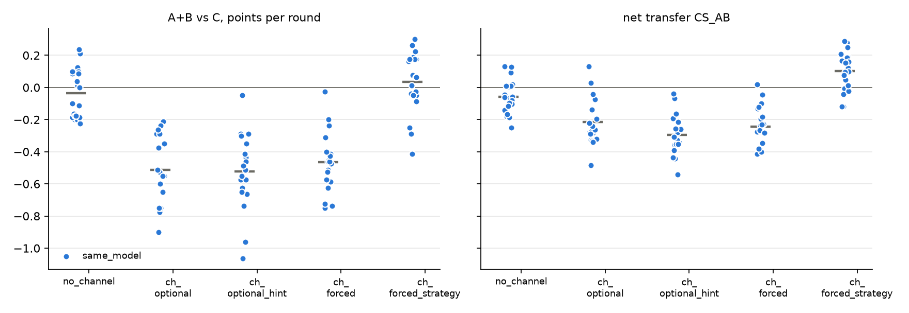

# v2 campaigns: 20261025-1837_same_model_glm32b_big-v4

Analysed 2026-10-25 20:48, 100 games.

## Coalition, plans and detection

| design | condition | games | final A / B / C | A+B vs C /round | CS_AB | plan executed | channel use A / B | same move | assist | 6-cycle played | die table played | table followed A / B | betrayal | C per round (0.5 if table followed) | H(a) A/B/C | H(a|s) A/B/C | net-inf fixed / calib. | P(move played) A/B/C | intended = top-1 at MOVE | truncated / parse fails | longest prompt |
|---|---|---|---|---|---|---|---|---|---|---|---|---|---|---|---|---|---|---|---|---|---|
| same_model | no_channel | 20 | 38.7 / 38.0 / 40.5 | -0.04 [-0.10, +0.03] | -0.06 [-0.10, -0.01] | - | - / - | 42% | 58% | 12% | 9% | 31% / 33% | 33% | 0.67 | 1.52 / 1.52 / 1.55 | 0.69 / 0.77 / 0.80 | 3 / 0 of 20 | 98% / 97% / 98% | 69% | 245 / 62 | 3098 |
| same_model | channel_optional | 20 | 31.2 / 31.6 / 62.1 | -0.51 [-0.59, -0.42] | -0.21 [-0.27, -0.15] | - | 97% / 96% | 68% | 32% | 6% | 6% | 33% / 34% | 33% | 1.03 | 1.42 / 1.43 / 1.40 | 0.92 / 0.93 / 0.76 | 13 / 11 of 20 | 100% / 100% / 98% | 88% | 117 / 26 | 8973 |
| same_model | channel_optional_hint | 20 | 32.4 / 30.8 / 63.0 | -0.52 [-0.63, -0.43] | -0.29 [-0.35, -0.24] | - | 97% / 96% | 75% | 25% | 4% | 4% | 36% / 32% | 34% | 1.05 | 1.48 / 1.49 / 1.40 | 0.96 / 0.94 / 0.74 | 18 / 13 of 20 | 100% / 100% / 98% | 90% | 114 / 25 | 8990 |
| same_model | channel_forced | 20 | 32.9 / 33.8 / 61.2 | -0.47 [-0.54, -0.39] | -0.24 [-0.30, -0.19] | 89% | 100% / 100% | 75% | 25% | 4% | 4% | 34% / 33% | 34% | 1.02 | 1.46 / 1.47 / 1.43 | 0.98 / 1.00 / 0.76 | 19 / 15 of 20 | 100% / 100% / 98% | 90% | 138 / 27 | 8980 |
| same_model | channel_forced_strategy | 20 | 40.6 / 43.0 / 39.8 | +0.03 [-0.05, +0.11] | +0.10 [+0.04, +0.15] | 44% | 100% / 100% | 22% | 78% | 13% | 32% | 51% / 48% | 22% | 0.66 | 1.53 / 1.53 / 1.54 | 0.89 / 0.91 / 0.82 | 8 / 0 of 20 | 95% / 94% / 97% | 84% | 808 / 157 | 9203 |

## Reflection (pooled statements; n in brackets)

| design | condition | player | intention = action | accounting errors | optimism (says ahead/level, is behind) | pessimism | predicts others | change if 'not working' | change if 'working' | change if correctly behind | change if wrongly behind |
|---|---|---|---|---|---|---|---|---|---|---|---|
| same_model | no_channel | A+B | 67% (2379) | 2% (2022) | 3% (1540) | 25% (855) | 35% (4581) | 67% (580) | 58% (373) | 66% (1407) | 59% (206) |
| same_model | no_channel | C | 66% (1198) | 1% (965) | 6% (653) | 15% (543) | 35% (2318) | 64% (223) | 63% (246) | 67% (582) | 49% (79) |
| same_model | channel_optional | A+B | 94% (2363) | 4% (1498) | 8% (2132) | 16% (265) | 70% (4492) | 51% (554) | 54% (1337) | 54% (1835) | 44% (43) |
| same_model | channel_optional | C | 73% (1187) | 1% (942) | 4% (118) | 5% (1082) | 45% (2323) | 55% (99) | 48% (631) | 62% (113) | 57% (51) |
| same_model | channel_optional_hint | A+B | 95% (2363) | 4% (1369) | 8% (2154) | 17% (241) | 71% (4457) | 54% (578) | 54% (1382) | 57% (1872) | 44% (39) |
| same_model | channel_optional_hint | C | 77% (1184) | 1% (934) | 11% (75) | 2% (1125) | 44% (2316) | 54% (81) | 43% (680) | 63% (65) | 48% (21) |
| same_model | channel_forced | A+B | 96% (2365) | 7% (1148) | 9% (1988) | 21% (400) | 71% (4482) | 99% (682) | 97% (1214) | 98% (1705) | 99% (84) |
| same_model | channel_forced | C | 75% (1191) | 1% (948) | 7% (206) | 6% (994) | 41% (2296) | 57% (137) | 40% (530) | 62% (190) | 53% (58) |
| same_model | channel_forced_strategy | A+B | 91% (1580) | 13% (1293) | 8% (1431) | 28% (960) | 63% (2040) | 99% (296) | 99% (1828) | 99% (1247) | 99% (250) |
| same_model | channel_forced_strategy | C | 65% (1193) | 2% (947) | 6% (748) | 15% (451) | 35% (2327) | 66% (244) | 64% (205) | 68% (658) | 65% (65) |

## Debrief understanding (correct / readable claims)

| design | condition | own strategy right (A+B / C) | who benefited right (A+B / C) | 'partner kept plan' right | C suspicion right | C suspects A-B |
|---|---|---|---|---|---|---|
| same_model | no_channel | 27/34 / 3/9 | 38/40 / 20/20 | - | 6/15 | 9/15 |
| same_model | channel_optional | 28/35 / 12/20 | 40/40 / 20/20 | - | 2/13 | 11/13 |
| same_model | channel_optional_hint | 34/37 / 16/20 | 40/40 / 20/20 | - | 4/14 | 10/14 |
| same_model | channel_forced | 25/29 / 15/19 | 39/39 / 20/20 | 18/29 | 2/15 | 13/15 |
| same_model | channel_forced_strategy | 33/33 / 9/14 | 25/36 / 18/18 | 39/40 | 3/14 | 10/14 |

## Per model and seat

| model | seat | games | mean final score | H(a) | intention = action | optimism | move parse failures |
|---|---|---|---|---|---|---|---|
| zai-org/GLM-4-32B-0414 | A | 100 | 35.1 | 1.48 | 89% | 5% | 297 |
| zai-org/GLM-4-32B-0414 | B | 100 | 35.4 | 1.49 | 88% | 9% | 297 |
| zai-org/GLM-4-32B-0414 | C | 100 | 53.3 | 1.46 | 71% | 6% | 297 |

## False alarms in no_channel

| design | games | rate [95% CI] |
|---|---|---|
| same_model | 1/20 | 5% [1, 24] |

