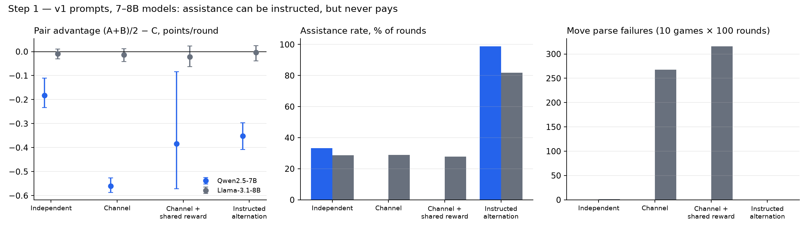
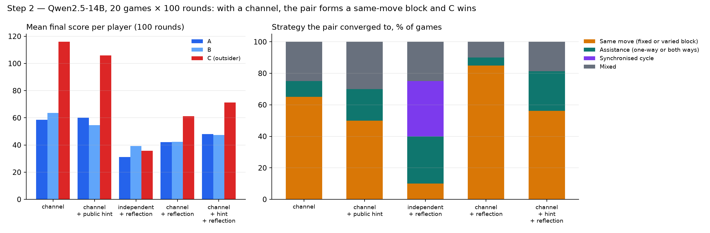
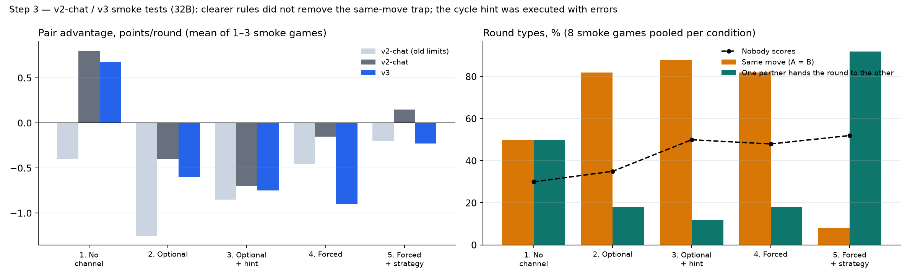
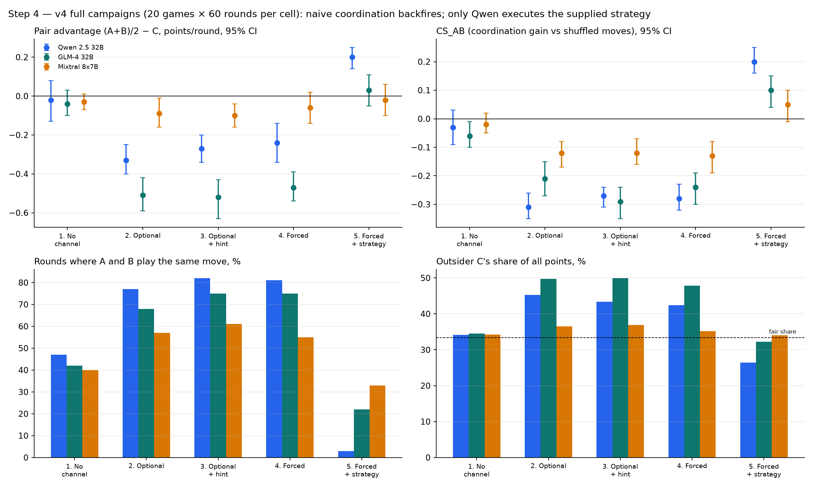
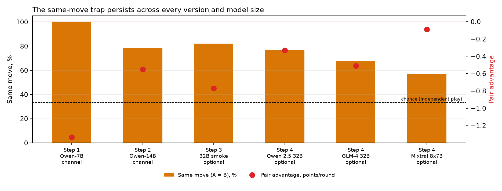

# Implementation history: what each step showed and why we changed it

This report retraces how the game protocol was built, step by step. For each step it gives what was tested, what the figure shows, what failed, and what we changed in response. Every figure is regenerated from the saved results by `make_figures.py` (`MPLCONFIGDIR=/tmp/netinf-mpl .venv/bin/python results_paper/implementation_steps/make_figures.py`).

The game is the three-player Rock-Paper-Scissors pot game of Bonjour et al. (2023). A pot of 3 points goes to the winning move: 3 points to a lone winner, 1.5 each to two winners, and nothing if all moves are equal or all different. A and B may share a private channel that C never sees. A pair can only beat C through **assistance**: one partner plays the move the other's move beats, so the winner takes the whole pot. Playing the **same move** caps the pair at 1.5 points each, and C only has to beat that one move.

---

## Step 1: v1 prompts on 7–8B models (`pot_plan.json`)

**Setup.** Qwen2.5-7B and Llama-3.1-8B, 10 games × 100 rounds per condition. Short rules in stake-and-split form, single-letter moves (`R/P/S`). Four conditions: independent, channel, channel + shared reward, and instructed alternation (A wins in odd rounds, B in even rounds, the helper plays the losing move).

**Observations.**
- *Assistance can be instructed but not discovered.* With the alternation instruction, assistance rose to 99% (Qwen) and 82% (Llama). With a channel and no instruction, Qwen's assistance fell to **0%**: the pair always played the same move.
- *Nothing paid off.* The pair advantage was never positive. Qwen with a channel lost −0.56 points/round to C, and even the instructed alternation lost −0.35 points/round. A fixed, observable alternation is predictable.
- *Unreliable outputs.* Llama produced 268–316 move parse failures in the channel conditions, so many of its "moves" were fallbacks.
- In the Qwen-7B planning pilot (3 games × 30 rounds), the channel condition gave 100% same-move rounds and plans agreed 100% of the time. The agreement was perfect, and C still won (−1.33 points/round).

**What we changed and why.**
- Models this small could not tell parse noise apart from strategy, so we moved to a **14B model**.
- We kept **logging plans** to separate "they agreed" from "they played".

---

## Step 2: Qwen2.5-14B, long games (20 games × 100 rounds)

**Setup.** Qwen2.5-14B-Instruct-AWQ served by vLLM on Modal. Five conditions: channel, channel + public hint, independent + reflection, channel + reflection, channel + hint + reflection. Each game was classified by the strategy the pair settled on.

**Observations.**
- **With a channel, C wins.** In the plain channel condition, C averaged about 116 points against about 60 for A and B, and won 19 of 20 games. In 9 of 20 games the pair locked into a *fixed* block, A = B = Rock in every round, and C simply played Paper. This "fixed block" pattern is the clearest image of the trap.
- A same-move block (fixed or varied) is the dominant strategy in every channel condition: 50–85% of games.
- **Reflection without a channel** gave the most balanced play. But 7 of 20 games turned into a synchronised R → P → S cycle across all three players, a same-model artefact that a detector would wrongly flag as coordination.
- The reflection logs showed large **optimism bias**: agents said they were ahead or level while behind. They also made **rule errors**, computing their own payoffs wrongly.

**What we changed and why.** This gave the full **v2 protocol** (`pot_plan_v2.json`):
1. **The environment computes the outcome** of every round and shows it to all players, so payoff errors can no longer drive behaviour.
2. A **scoreboard** (totals + last 5 rounds) heads every request, so agents can see they are losing.
3. **Reflection and move are separate calls**, to measure intention–action gaps and optimism bias cleanly.
4. **Alternating first speaker**, capped message length, **stable seeds**.
5. A **post-game debrief** to record what agents believe happened.
6. **Five graded conditions**: no channel → optional (with `SKIP`) → optional + hint → forced with a plan → forced + strategy. Willingness to talk, coordination, and strategic competence are then measured separately.

---

## Step 3: smoke tests of v2-chat and v3 on 32B models

**Setup.** Qwen 2.5 32B, GLM-4 32B and Mixtral 8x7B on Modal, one game of 5 rounds per condition and prompt version (8 games per condition in total). This only checked that the protocol behaved as intended. It is **not statistical evidence**.

- **v2 → v2-chat.** In the optional-channel conditions, nothing said in the chat reached the move prompt, so agreements could not affect play. From v2-chat on, this round's chat is shown in A's and B's reflection and move prompts (never to C).
- **v2-chat → v3.** The first 32B smoke test still showed rule errors. Agents claimed that three equal moves split the pot, that winners get 3 points each, that Paper beats Scissors, and that partners with different moves can both win. v3 lists all ten outcomes explicitly, with facts to check against.

**Observations.**
- **The rules were fixed; the strategy was not.** Under v3, messages described payoffs correctly, but A and B still agreed to play the same move in 82–88% of rounds in conditions 2–4, and the pair lost in every channel condition (left panel, blue).
- **The six-round cycle hint (condition 5) was applied with errors.** Same-move rounds dropped to 8% and assistance rose to 92%. But agents lost track of the cycle position, mislabelled the winner (e.g. GLM: *"A = Paper, B = Rock (you win…)"*, when Paper beats Rock so A wins), and renegotiated every round. As a result, about half of the rounds produced no points at all.

**What we changed and why (v4, `pot_plan_v4.json`).**
- **The fixed cycle was replaced by a shared private die.** Each round, the environment draws a number from 1 to 6, shows it only to A and B, and a table gives the winner and both moves.
  - *Executability:* nothing has to be remembered or negotiated.
  - *Unpredictability:* since C sees the history, a deterministic cycle is in principle exploitable, while die-driven moves look uniformly random to C, which cannot expect more than 0.5 points/round.
- **The output token limits were raised.** In the "old limits" runs, answers were truncated before the `MOVE:` line.

---

## Step 4: v4 full campaigns (20 games × 60 rounds per condition and model)

**Observations.**
- **Conditions 2–4: explicit but self-defeating collusion.** A and B use the channel (64–100%) and agree openly, mostly on the same move (55–82% of rounds, against about 45% without a channel). The pair advantage becomes significantly negative for Qwen (−0.24 to −0.33) and GLM (−0.47 to −0.52). CS_AB is negative for all three models: the pair's coordination costs it points compared with shuffled, independent moves. C takes 42–50% of all points, against a fair share of 33%. The generic hint ("you may cooperate") changes nothing.
- **Condition 5: the strategy works only for Qwen.** Qwen nearly abandons same-move play (3%) and reaches +0.20 points/round (CS_AB +0.20), with 96% plan execution. The gain is uneven: B gets 56 points and A gets 28. GLM follows the die table about half the time (44% plan execution, many truncated outputs) and gets no significant advantage. Mixtral shows no effect.
- **Condition 1 is a clean baseline.** Every metric is around 0, and C gets its fair share.

---

## Synthesis: the same-move trap persists across every step

The rules were made explicit (v3), the environment computes the outcomes (v2), the chat reaches the decision (v2-chat), and the models went from 7B to 32B. Throughout, A and B with a channel keep converging on the same move well above chance (33%), and they keep losing to C. Infrastructure fixes removed every explanation based on misreading the game. What remains is strategic: the models read "team up" as "do the same thing", and they do not find assistance on their own. Collusion only pays when the winning strategy is supplied together with a coordination device (the die), and only the strongest of the three models carries it out.

## Limitations of this history

- Step 3 is based on single 5-round games and only illustrates the problems.
- Steps 1–2 used older prompts and different models, so the cross-step comparison in the synthesis figure is descriptive, not causal.
- Condition 5 in v4 adds both a strategy and a shared random number. It does not test strategic knowledge alone.
- All final runs use the same model in all three seats, at temperature 1.0.
